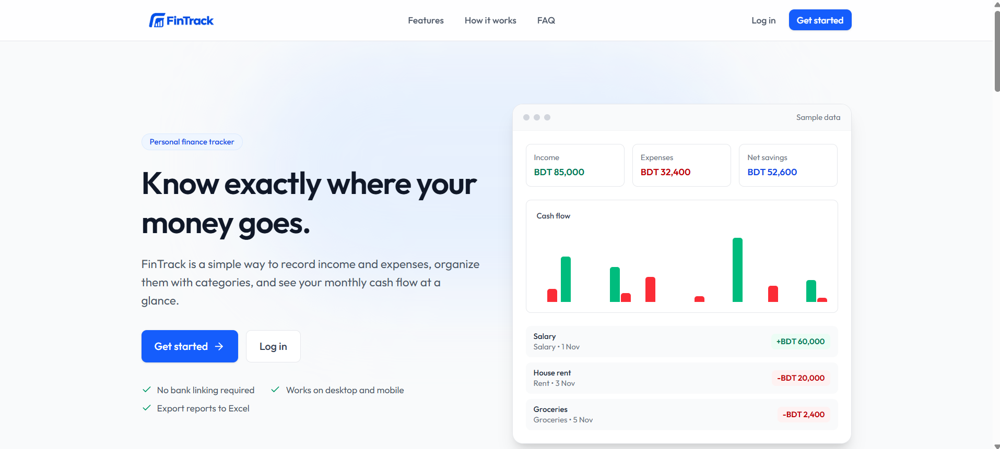
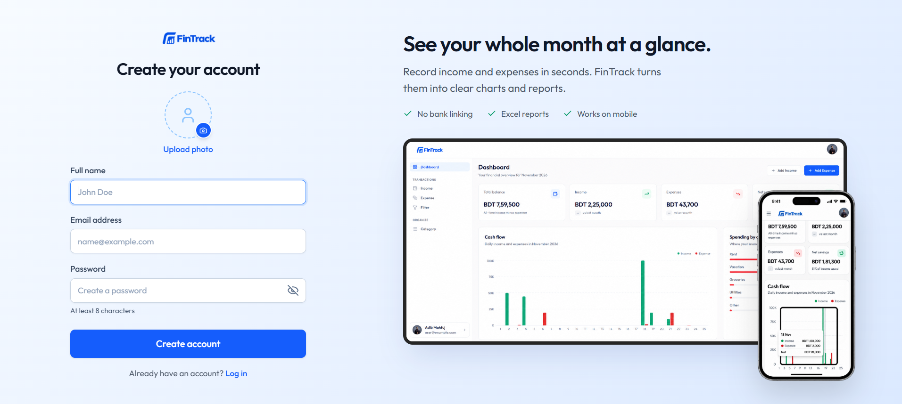
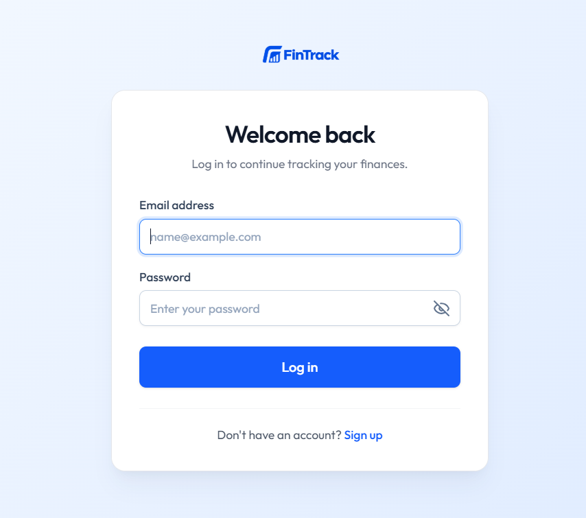
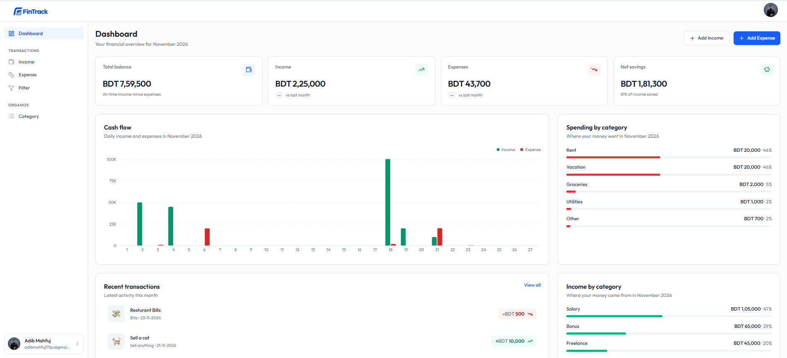
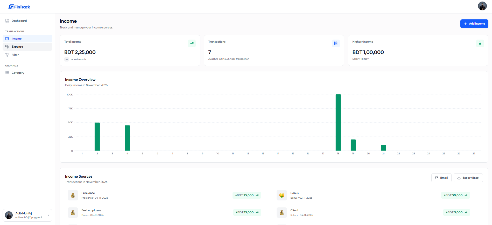
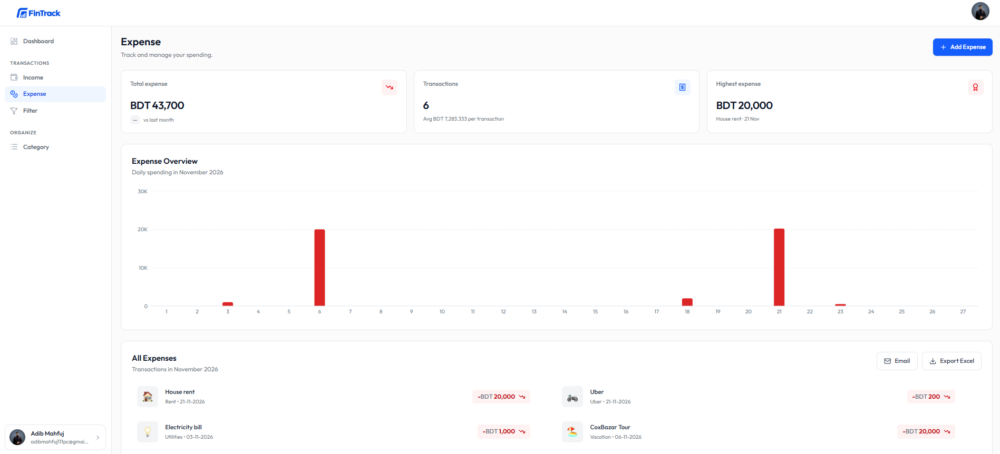
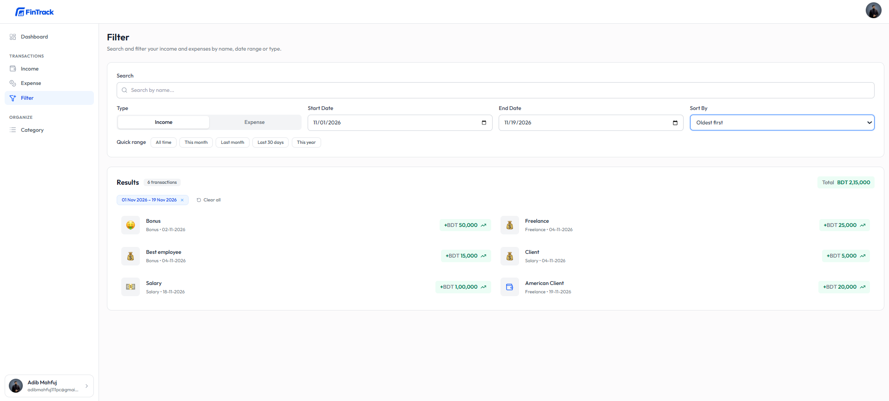
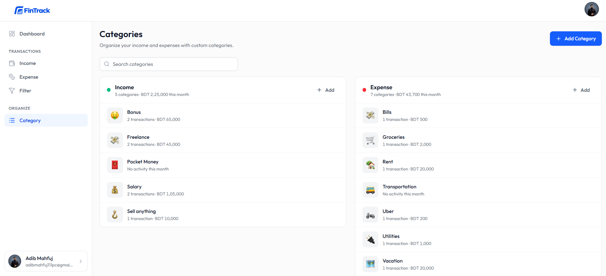

<div align="center">

# FinTrack — Frontend

**A modern personal finance management web application.**
Track income and expenses, organize categories, filter transactions, and understand your money through clear visual insights.


</div>

---

## Table of Contents

- [Overview](#overview)
- [Features](#features)
- [Screenshots](#screenshots)
- [Tech Stack](#tech-stack)
- [Project Structure](#project-structure)
- [Getting Started](#getting-started)
- [Environment Variables](#environment-variables)
- [Available Scripts](#available-scripts)
- [Backend](#backend)
- [Design System](#design-system)
- [Roadmap](#roadmap)
- [Contributing](#contributing)
- [License](#license)
- [Author](#author)

---

## Overview

FinTrack is a full-stack personal finance manager. This repository contains the **React frontend**, a single-page application that communicates with the FinTrack REST API built with Spring Boot.

The interface follows a clean, consistent SaaS dashboard style: a white surface, light gray borders, a blue brand color, emerald for income, and red for expenses and destructive actions.

## Features

- **Authentication** — Secure sign-up and login using JWT, with protected routes and persistent sessions
- **Dashboard** — Financial overview with summary cards and interactive charts
- **Income management** — Add, edit, delete, and review income sources with validation
- **Expense management** — Full expense tracking with the same workflow as income
- **Category management** — Create and edit income and expense categories with an emoji icon picker and duplicate-name validation
- **Advanced filtering** — Filter transactions by type, date range, keyword, and sort order
- **Data export** — Download transactions as an `.xlsx` file and send them by email
- **Profile management** — Update user details and upload a profile photo (Cloudinary)
- **Feedback and safety** — Toast notifications and confirmation modals for permanent actions
- **Responsive layout** — Works across desktop and mobile screen sizes

## Screenshots

| Home | Sign Up |
| :---: | :---: |
|  |  |

| Login | Dashboard |
| :---: | :---: |
|  |  |

| Income | Expense |
| :---: | :---: |
|  |  |

| Filter | Category |
| :---: | :---: |
|  |  |

## Tech Stack

| Area | Technology |
| --- | --- |
| Framework | React (Vite) |
| Routing | React Router |
| State management | Context API |
| Styling | Tailwind CSS |
| Icons | Lucide React |
| Charts | Recharts |
| Notifications | React Hot Toast |
| HTTP client | Axios |
| Media storage | Cloudinary (profile photos) |
| Session storage | localStorage (JWT) |

## Project Structure

```text
fintrackwebapp/
├── public/
├── src/
│   ├── assets/          # Images and logo
│   ├── components/      # Reusable UI components (sidebar, menubar, forms, charts, lists)
│   ├── context/         # Global application context
│   ├── hooks/           # Reusable hooks for dashboard data, user state, and utilities
│   ├── pages/           # Home, Income, Expense, Category, Filter, Login, Signup
│   ├── util/            # API endpoints and helper functions
│   ├── App.jsx
│   └── main.jsx
├── .env                 # Local environment variables (not committed)
├── index.html
├── package.json
└── vite.config.js
```

## Getting Started

### Prerequisites

- [Node.js](https://nodejs.org/) 18 or later
- npm 9 or later
- The [FinTrack backend](https://github.com/Adib-Mahfuj/FinTrack) running locally on `http://localhost:8080`

### Installation

```bash
# 1. Clone the repository
git clone https://github.com/Adib-Mahfuj/FinTrack-Frontend.git

# 2. Move into the project directory
cd FinTrack-Frontend

# 3. Install dependencies
npm install

# 4. Create the environment file (see the next section)
cp .env.example .env

# 5. Start the development server
npm run dev
```

The app will be available at `http://localhost:5173`.

## Environment Variables

Create a `.env` file in the project root:

```env
VITE_API_BASE_URL=http://localhost:8080
CLOUDINARY_CLOUD_NAME=your_cloud_name
CLOUDINARY_UPLOAD_PRESET=your_unsigned_upload_preset
```

| Variable | Description |
| --- | --- |
| `VITE_API_BASE_URL` | Base URL of the FinTrack backend API |
| `CLOUDINARY_CLOUD_NAME` | Cloudinary cloud name used for profile photo uploads |
| `CLOUDINARY_UPLOAD_PRESET` | Unsigned Cloudinary upload preset |

> Never commit your `.env` file. Only commit `.env.example` with placeholder values.

## Available Scripts

| Command | Description |
| --- | --- |
| `npm run dev` | Start the development server with hot reload |
| `npm run build` | Create an optimized production build in `dist/` |
| `npm run preview` | Preview the production build locally |
| `npm run lint` | Run ESLint on the project |

## Backend

The API is built with Spring Boot, Spring Security (JWT), and MySQL / PostgreSQL.
Repository: [Adib-Mahfuj/FinTrack](https://github.com/Adib-Mahfuj/FinTrack)

## Design System

The UI follows one consistent design language across all pages:

| Role | Color |
| --- | --- |
| Brand / primary actions | Blue |
| Income / success | Emerald |
| Expense / destructive actions | Red |
| Text, borders, surfaces | Gray / Slate |

Interactions are kept subtle (short color transitions only). Destructive actions always require confirmation.

## Roadmap

- [ ] Deploy frontend and backend (live demo links will be added here)
- [ ] Add automated tests
- [ ] Add dark mode
- [ ] Add budget goals and spending alerts

## Contributing

Contributions, issues, and feature requests are welcome.

1. Fork the repository
2. Create a feature branch: `git checkout -b feature/your-feature`
3. Commit your changes: `git commit -m "feat: add your feature"`
4. Push the branch: `git push origin feature/your-feature`
5. Open a Pull Request

## License

Distributed under the MIT License. See [`LICENSE`](LICENSE) for details.

## Author

**Adib Mahfuj**
Junior Full-Stack Developer (React & Spring Boot)

- GitHub: [@Adib-Mahfuj](https://github.com/Adib-Mahfuj)
- LinkedIn: [Adib Mahfuj](https://www.linkedin.com/in/adibmahfuj/)
- Email: adibmahfuj.dev@gmail.com
